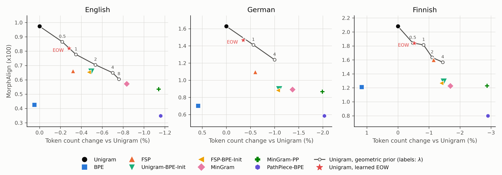

# A length prior for Unigram tokenization

This branch holds the code and results for one question: what happens when the length prior that the Unigram model definition includes, and that every implementation drops, is kept. The results are compared with MinGram and the other methods of the MinGram paper on the same corpora. The code changes are on this branch; the setup, reproduction and verification details are at the end of this page.

## The problem

The Unigram tokenizer treats a word as a sequence of tokens drawn from a single probability table. Under the model definition, the number of tokens m is drawn first from a prior P(M = m) and then m tokens are drawn independently, so a segmentation v = (v_1, ..., v_m) has probability

    P(v) = P(M = m) * phi(v_1) * ... * phi(v_m)

where phi is the probability table over the vocabulary. SentencePiece and the implementation in this repository score a segmentation by the product of the token probabilities alone. The P(M = m) term is gone, and with it any preference for fewer tokens. Two segmentations of the same word with different numbers of tokens are compared only through the products of their token probabilities, which is not a probability distribution over strings.

MinGram goes the other way: it picks the segmentation with the fewest tokens and uses the token probabilities only to break ties. In the MinGram paper this gives 1.8 percent fewer tokens than Unigram on held-out text, at the cost of a lower agreement with morpheme boundaries. The question here is whether putting the dropped prior back, in a principled way, yields some of that compression while more of Unigram's morphological alignment is kept.

## The two approaches

Both approaches use the model from the blog post [UnigramLM: An Attempt at Writing the Missing Manual](https://cimeister.github.io/blog/unigramlm/), Equations 1 and 2 there: the number of tokens m is drawn from a prior P(M = m), then m tokens are drawn independently from the table phi. Both use a geometric prior,

    P(M = m) = (1 - rho) * rho^(m - 1)      for m >= 1,  0 < rho < 1,

which sums to one over m. Taking logs,

    log P(v) = log(1 - rho) - log(rho) + m * log(rho) + sum_t log phi(v_t).

The first two terms are the same for every segmentation of every word. Writing lambda = -log(rho), the part that differs between segmentations is

    score(v) = sum_t log phi(v_t) - lambda * m,

so the geometric prior is a penalty of lambda nats per token. The posterior over the segmentations of a word (Equation 5 of the post) is proportional to exp(score(v)), and the Viterbi segmentation (Equation 6) is the one with the largest score. The two approaches differ in whether rho is fixed in advance or learned from the data, and in how the penalty is stored.

### Fixed penalty (geometric)

Here lambda is a hyperparameter. It enters in three places.

- Expectation step of training: the posterior over segmentations is proportional to exp(score(v)), so every lattice arc carries log phi(v) - lambda. The expected token counts c_v are computed under this posterior.
- Maximization step: unchanged, phi_v = c_v / sum_u c_u. The prior term is constant in phi for a fixed vocabulary (Equation 14 of the post), so lambda changes phi only through the counts.
- Pruning: the repository estimates the likelihood lost by removing a token v by comparing log phi(v) with the log probability of the best alternative segmentation of v's own string, with k tokens. With the prior, both sides are scored with the penalty, the token once and the alternative k times, so the estimate increases by (c_v / T) * lambda * (k - 1), with c_v the token's count and T the total count. A token whose removal would add tokens is harder to remove, which is the same preference the expectation step expresses.

The stored table phi is normalized over tokens and lambda is stored next to it, so when text is segmented the penalty must be subtracted from every arc explicitly. That is the change made to `encode`. Before this change the repository subtracted a `token_bias` during training only and segmented text without it, so a model trained with a penalty was used with a different objective than it was trained with.

### Learned end-of-word probability (EOW)

Footnote 3 of the post describes the standard way to make a proper distribution over variable-length sequences: an end-of-sequence symbol with its own probability. The table gains one outcome, end of word, with probability psi_eow, and the tokens get probabilities psi_v, with

    sum_v psi_v + psi_eow = 1.

A word is generated by drawing from this table until the end-of-word outcome is drawn, so a segmentation with m tokens has probability

    P(v) = psi_eow * psi(v_1) * ... * psi(v_m).

This is the model of the post with a geometric prior. Define phi_v = psi_v / (1 - psi_eow), which is a probability table over the tokens alone, and rho = 1 - psi_eow. Then

    P(v) = psi_eow * (1 - psi_eow)^m * prod_t phi(v_t) = (1 - rho) * rho^m * prod_t phi(v_t),

which is P(M = m) * prod_t phi(v_t) with P(M = m) = (1 - rho) rho^m, the geometric prior counted from m = 0. For a non-empty word the m = 0 case never occurs, and the remaining difference from the prior above is one constant factor rho, the same for every segmentation. So comparisons between segmentations are exactly those of the geometric prior with

    lambda = -log(rho) = -log(1 - psi_eow).

The parameter rho is learned by EM together with phi. In the expectation step the expected count of the end-of-word outcome is N, the number of word occurrences in the corpus, because every occurrence ends exactly once; the token counts c_v are computed as usual, under posteriors that already include the penalty. In the maximization step the table that maximizes sum_v c_v log psi_v + N log psi_eow under the constraint that it sums to one is

    psi_v = c_v / (sum_u c_u + N),      psi_eow = N / (sum_u c_u + N),

the usual count-divided-by-total update, now with N in the total. This is also the maximum-likelihood estimate of rho: with r = sum_u c_u / N the expected number of tokens per word, rho = r / (1 + r), so lambda = log(1 + 1/r). The implementation keeps this estimate as a scalar; no end-of-word token exists in the vocabulary or in any output.

The stored table is psi, not phi. Since log psi(v) = log phi(v) - lambda, the penalty is already inside the stored numbers, and the score of a segmentation under the stored table,

    sum_t log psi(v_t) = sum_t log phi(v_t) - lambda * m,

is exactly the geometric score. That is why nothing changes when text is segmented: the ordinary Viterbi over the stored table is the Viterbi with the prior. The same applies to pruning, where the total T now includes N. An EOW model is identical to a fixed-penalty model with lambda = -log(1 - psi_eow) whose penalty was folded into the table. The only difference between the two approaches is whether lambda is held fixed or re-estimated at every maximization step; the separate storage of lambda in the fixed-penalty variant is bookkeeping, and folding it into the table would be equivalent.

### A worked example

The post's example word is "hat" with phi(h) = 0.3, phi(a) = 0.1, phi(t) = 0.25, phi(ha) = 0.2, phi(at) = 0.15. It has three segmentations. The posterior over them is the score of each divided by the sum of the three.

| Segmentation | Tokens | Standard: product of phi | Posterior | EOW with psi_eow = 0.4: product of psi = 0.6 phi | Posterior | Fixed lambda = 1: product of phi times exp(-1) per token | Posterior |
|---|---|---|---|---|---|---|---|
| h, a, t | 3 | 0.0075 | 0.073 | 0.00162 | 0.045 | 0.000373 | 0.028 |
| ha, t | 2 | 0.0500 | 0.488 | 0.01800 | 0.503 | 0.006767 | 0.511 |
| h, at | 2 | 0.0450 | 0.439 | 0.01620 | 0.452 | 0.006090 | 0.460 |

The common factor psi_eow = 0.4 is left out of the EOW column; it multiplies all three scores and cancels in the posterior. What does not cancel is the factor 0.6 per token: the three-token segmentation carries 0.6 cubed and the two-token ones 0.6 squared, so the odds of two tokens against three rise from 6.7 to 1 to 11.1 to 1, a factor of 1/0.6. The two two-token segmentations keep their ratio of 1.11 to 1. The fixed penalty does the same with exp(-1) = 0.368 in place of 0.6. Over a corpus, the expected counts of longer tokens rise under these posteriors, the next maximization step gives them more probability, and more of them survive pruning; that is how the prior changes the learned vocabulary rather than only the choice among segmentations under a fixed vocabulary.

### Where the implementation approximates

The maximization step uses the digamma form of the count update when `m_step_digamma` is on, as in the paper's configuration, so the stored table sums to slightly less than one minus psi_eow. The final pruning to the target vocabulary size removes tokens after the last maximization step without renormalizing, for every Unigram variant. And the pruning criterion is the usual SentencePiece-style estimate, not the exact likelihood loss. None of these is specific to the length prior; the prior is applied exactly in the expectation step, the maximization step and inference.

A third variant, a learned non-parametric prior over the token count, requires a lattice indexed by position and token count and was not run.

## Results

All results are on the Goldfish evaluation corpora, with tokenizers trained on 5 GB FineWeb samples per language (details at the end). Compression is the percent change in token count relative to the standard Unigram tokenizer trained on the same sample; negative means fewer tokens. MorphAlign is a score of agreement with morpheme boundaries from UniMorph-derived gold segmentations, available for English, German and Finnish, multiplied by 100; higher is better.

### Compression

Percent change in Goldfish token count relative to Unigram. The mean is over the six languages. Rows are ordered by the mean. The first seven rows are the methods of the MinGram paper, retrained here.

| Method | English | German | Finnish | Russian | Arabic | Korean | Mean |
|---|---|---|---|---|---|---|---|
| PathPiece-BPE | -1.16 | -2.03 | -2.90 | -2.67 | -2.58 | -2.79 | -2.35 |
| MinGram-PP | -1.14 | -1.99 | -2.87 | -2.62 | -2.54 | -2.76 | -2.32 |
| MinGram | -0.84 | -1.37 | -1.69 | -2.33 | -2.19 | -2.54 | -1.83 |
| Unigram-BPE-Init | -0.50 | -1.10 | -1.47 | -2.09 | -1.90 | -2.07 | -1.52 |
| FSP-BPE-Init | -0.47 | -1.07 | -1.40 | -2.04 | -1.88 | -2.03 | -1.48 |
| Unigram, geometric prior, lambda = 4 | -0.70 | -1.00 | -1.44 | -1.28 | -1.31 | -1.77 | -1.25 |
| FSP | -0.32 | -0.60 | -1.15 | -1.03 | -1.12 | -1.53 | -0.96 |
| Unigram, geometric prior, lambda = 1 | -0.35 | -0.56 | -0.82 | -0.59 | -0.70 | -0.94 | -0.66 |
| Unigram, learned EOW | -0.28 | -0.35 | -0.53 | -0.40 | -0.49 | -0.66 | -0.45 |
| BPE | +0.05 | +0.59 | +1.17 | -1.22 | -0.89 | -1.99 | -0.38 |

Lambda is the per-token penalty in nats. The learned EOW penalty came out between 0.53 and 0.65 nats in every language (table below), so the EOW row corresponds to a penalty of about 0.6.

### Morphological alignment

MorphAlign score times 100; higher means closer agreement with morpheme boundaries. The last column is the geometric mean over the three languages. Rows ordered by that mean.

| Method | English | German | Finnish | Geometric mean |
|---|---|---|---|---|
| Unigram | 0.97 | 1.63 | 2.08 | 1.49 |
| Unigram, learned EOW | 0.82 | 1.47 | 1.84 | 1.30 |
| Unigram, geometric prior, lambda = 1 | 0.78 | 1.41 | 1.81 | 1.26 |
| Unigram, geometric prior, lambda = 4 | 0.65 | 1.24 | 1.57 | 1.08 |
| FSP | 0.66 | 1.09 | 1.60 | 1.05 |
| Unigram-BPE-Init | 0.66 | 0.89 | 1.29 | 0.91 |
| FSP-BPE-Init | 0.65 | 0.88 | 1.27 | 0.90 |
| MinGram | 0.57 | 0.89 | 1.23 | 0.85 |
| MinGram-PP | 0.53 | 0.87 | 1.23 | 0.83 |
| BPE | 0.43 | 0.70 | 1.21 | 0.71 |
| PathPiece-BPE | 0.35 | 0.58 | 0.80 | 0.55 |

### Compression against alignment

The figure plots, for English, German and Finnish, the MorphAlign score times 100 against the percent change in Goldfish token count relative to Unigram. The geometric-prior runs form a line from Unigram through increasing lambda; the learned EOW run is marked separately; the other methods are single points.

The numbers behind the figure are in `report/figures/morphalign_vs_compression.csv`.

### The penalty sweep, English and Finnish

Compression as above, in percent; MorphAlign times 100. The EOW row is placed at its learned penalty.

| Penalty, nats | English compression | English MorphAlign | Finnish compression | Finnish MorphAlign |
|---|---|---|---|---|
| 0 (standard Unigram) | 0 | 0.97 | 0 | 2.08 |
| 0.5 | -0.22 | 0.87 | -0.48 | 1.84 |
| learned EOW (0.65 English, 0.54 Finnish) | -0.28 | 0.82 | -0.53 | 1.84 |
| 1 | -0.35 | 0.78 | -0.82 | 1.81 |
| 2 | -0.54 | 0.70 | -1.10 | 1.64 |
| 4 | -0.70 | 0.65 | -1.44 | 1.57 |
| 8 | -0.76 | 0.60 | not run | not run |

### The learned penalty

The end-of-word probability learned in each language, the penalty -log(1 - psi_eow) in nats per token, and the tokens per word on the training corpus.

| Language | psi_eow | Penalty, nats | Tokens per word |
|---|---|---|---|
| English | 0.477 | 0.65 | 1.10 |
| German | 0.449 | 0.60 | 1.23 |
| Arabic | 0.449 | 0.60 | 1.23 |
| Russian | 0.435 | 0.57 | 1.30 |
| Finnish | 0.419 | 0.54 | 1.39 |
| Korean | 0.412 | 0.53 | 1.43 |

### The prior applied only at inference

Before training anything, the geometric penalty was applied at inference to the existing Unigram tokenizers. Percent change in token count relative to the same tokenizer without the penalty, mean over the six languages; MorphAlign geometric mean times 100 over the three languages.

| Penalty, nats | Mean compression | MorphAlign geometric mean |
|---|---|---|
| 0 | 0.00 | 1.49 |
| 0.5 | -0.05 | 1.47 |
| 1 | -0.08 | 1.45 |
| 2 | -0.11 | 1.43 |

## Discussion

**The prior only matters during training.** Applied only when segmenting text, a penalty of 2 nats changes the token count by 0.11 percent. The same penalty applied during training changes it by 0.54 percent in English and 1.10 percent in Finnish. The trained token probabilities are peaked enough that re-scoring rarely changes the chosen segmentation; the effect comes from the training loop, where the penalty raises the expected counts of longer tokens and more of those tokens survive pruning.

**EOW and the fixed penalty are one family, not two methods.** The learned EOW variant lies on the geometric trade-off curve: in English its compression (-0.28) and MorphAlign (0.82) fall between the lambda 0.5 and lambda 1 runs, and in Finnish they match the lambda 0.5 run. The difference is how the penalty is chosen. The EOW variant uses the value implied by a proper probability model over strings, approximately log(1 + 1/r) with r the tokens per word, and has no free parameter. Because r only ranges from 1.10 (English) to 1.43 (Korean), that value is close to 0.6 nats in every language, and it is a conservative point: 25 to 30 percent of MinGram's compression gain, with 87 percent of Unigram's MorphAlign geometric mean retained. The fixed penalty gives the rest of the curve.

**Where the family sits among the existing methods.** At lambda 1 the compression is close to FSP's (-0.66 against -0.96 mean) with much higher alignment (1.26 against 1.05). At lambda 4 the compression is larger than FSP's in every language (-1.25 against -0.96 mean) at about the same alignment (1.08 against 1.05). Against the BPE-initialized Unigram variants, lambda 4 gives less compression (-1.25 against -1.52) and higher alignment (1.08 against 0.91). No point on the curve reaches MinGram's compression: in English the gain is -0.70 at lambda 4 and -0.76 at lambda 8, against -0.84 for MinGram, with MorphAlign falling from 0.65 to 0.60 over that step.

**Languages differ in a consistent way.** The compression gain from a fixed penalty is larger where words are split into more tokens: at lambda 4 it is -0.70 in English (1.10 tokens per word) and -1.77 in Korean (1.43). A penalty only changes a decision where a word has more than one plausible segmentation, and such words are more common when words carry more tokens. As a fraction of MinGram's gain, the gain at lambda 4 is 83 percent in English, 85 in Finnish, 73 in German, 70 in Korean, 60 in Arabic and 55 in Russian. Russian and Arabic are where MinGram's gain over Unigram is largest, and the geometric prior yields a smaller share of it there than the minimum-token objective does. On alignment the ordering reverses: at lambda 4 the Finnish MorphAlign is 75 percent of Unigram's and the English one 67 percent.

**What MinGram does that the prior does not.** The inference rule of the geometric variant approaches MinGram's as lambda grows, but the compression does not converge to MinGram's. MinGram also trains differently: it uses the minimum-token segmentation as a hard assignment in each training step and prunes tokens by how often they are used, whereas the variants here keep the soft expectation step and the likelihood-based pruning. The remaining difference in compression is attributable to that training procedure, not to the inference rule.

## Limitations

One vocabulary size (32,768 learned tokens). One base configuration (the paper's Unigram with iterative pruning); FSP and BPE-initialized variants with a prior were not run. Training corpora are quick FineWeb samples, not the paper's uniform samples (described under Setup). No downstream language-model evaluation. MorphAlign covers three languages. The full penalty sweep exists for English and Finnish only; the other four languages have lambda 1 and 4.

## Setup

- Languages: English, German, Finnish, Russian, Arabic, Korean.
- Training corpora: 5 GB of text per language sampled from FineWeb (English) or FineWeb-2, by reading shuffled documents until 5 billion characters are collected (`fineweb_<lang>_5gb_quick` in `script_bpe/corpus/registry.py`). The MinGram paper uses a reservoir sample that is uniform over the source; the quick sample is a different, non-uniform sample of the same size.
- Pretokenization: SCRIPT encoding with character boundaries (`scriptenc_cb`), 1,916 atomic tokens.
- Vocabulary: 32,768 learned tokens plus the atomic tokens for every method.
- Evaluation corpora: the Goldfish fish-food corpora (`<lang>_fishfood`, 7 to 15 GB per language), downloaded 2026-10-30.
- MorphAlign: `eval/morph-tok-eval`, IBM1 alignment at threshold 0.01, UniMorph-derived gold files for English and German (CELEX) and Finnish (MorphyNet).
- Methods from the MinGram paper: BPE, Unigram, FSP, Unigram-BPE-Init and FSP-BPE-Init at overshoot factor 1.15, MinGram at factor 1.15 with 2 EM iterations, MinGram-PP at factor 8 with pruning factor 0.9 and minimum-increase pruning, PathPiece-BPE with an initial vocabulary of 262,144. ConvexTok was not run; its solver depends on a package that is not a project dependency.
- New methods: `--length-prior eow` and `--length-prior geometric --prior-lambda L` on `paper_utils/hybrid/train_model.py --method default`.
- Compute: all training on single nodes of CSCS Clariden (288 cores, 12-hour limit). Unigram-family training is single-threaded and took 2.2 hours (English) to 11.4 hours (Finnish) per model; MinGram took 12 to 50 minutes; BPE 5 to 18 minutes. Finnish Unigram runs were resumed from checkpoints after hitting the 12-hour limit (`--checkpoint`).

## Reproduction of the MinGram tables

Before adding rows, Tables 2 and 3 of the paper were regenerated with this setup. Each cell below is the value measured here with the paper's value in parentheses. Units as in the results section.

Compression, percent change in Goldfish token count relative to Unigram:

| Method | English | German | Finnish | Russian | Arabic | Korean | Mean |
|---|---|---|---|---|---|---|---|
| PathPiece-BPE | -1.16 (-1.18) | -2.03 (-2.14) | -2.90 (-2.87) | -2.67 (-2.71) | -2.58 (-2.59) | -2.79 (-2.69) | -2.35 (-2.37) |
| MinGram-PP | -1.14 (-1.16) | -1.99 (-2.10) | -2.87 (-2.85) | -2.62 (-2.66) | -2.54 (-2.56) | -2.76 (-2.67) | -2.32 (-2.33) |
| MinGram | -0.84 (-0.86) | -1.37 (-1.49) | -1.69 (-1.68) | -2.33 (-2.37) | -2.19 (-2.18) | -2.54 (-2.40) | -1.83 (-1.83) |
| Unigram-BPE-Init | -0.50 (-0.52) | -1.10 (-1.22) | -1.47 (-1.45) | -2.09 (-2.11) | -1.90 (-1.90) | -2.07 (-1.95) | -1.52 (-1.52) |
| FSP-BPE-Init | -0.47 (-0.49) | -1.07 (-1.17) | -1.40 (-1.38) | -2.04 (-2.07) | -1.88 (-1.87) | -2.03 (-1.91) | -1.48 (-1.48) |
| FSP | -0.32 (-0.33) | -0.60 (-0.72) | -1.15 (-1.16) | -1.03 (-1.05) | -1.12 (-1.10) | -1.53 (-1.40) | -0.96 (-0.96) |
| BPE | +0.05 (+0.03) | +0.59 (+0.46) | +1.17 (+1.16) | -1.22 (-1.25) | -0.89 (-0.92) | -1.99 (-1.88) | -0.38 (-0.40) |

MorphAlign times 100:

| Method | English | German | Finnish | Geometric mean |
|---|---|---|---|---|
| Unigram | 0.97 (0.98) | 1.63 (1.72) | 2.08 (2.02) | 1.49 (1.50) |
| FSP | 0.66 (0.67) | 1.09 (1.14) | 1.60 (1.61) | 1.05 (1.07) |
| Unigram-BPE-Init | 0.66 (0.66) | 0.89 (0.89) | 1.29 (1.27) | 0.91 (0.91) |
| FSP-BPE-Init | 0.65 (0.66) | 0.88 (0.89) | 1.27 (1.26) | 0.90 (0.90) |
| MinGram | 0.57 (0.57) | 0.89 (0.87) | 1.23 (1.23) | 0.85 (0.85) |
| MinGram-PP | 0.53 (0.53) | 0.87 (0.85) | 1.23 (1.29) | 0.83 (0.83) |
| BPE | 0.43 (0.43) | 0.70 (0.70) | 1.21 (1.21) | 0.71 (0.71) |
| PathPiece-BPE | 0.35 (0.34) | 0.58 (0.58) | 0.80 (0.78) | 0.55 (0.54) |

The method ranking is the paper's in every column, and every mean is within 0.02 of the paper. German and Korean differ from the paper by a constant 0.12 percentage points across all methods, in opposite directions. A shift common to every method is consistent with a change in the one quantity they share, the token count of the Unigram baseline; the cause is not established, and the different training sample is the plausible one.

## Verification

An independent check, run separately from the code that produced the tables, covered: the model file behind every cell and its stored configuration; recomputation of every compression cell from the raw token counts; token counts recomputed from scratch for four models (Finnish Unigram and MinGram from the reproduction, Finnish EOW and Korean lambda 4 from the new rows); re-scoring of six MorphAlign cells by calling the alignment tool directly on the stored segmentations; the learned EOW penalty against log(1 + 1/r); and that the geometric models apply their penalty when segmenting text (for English at lambda 4, 150 of 27,427 gold words segment differently with the penalty, all with fewer tokens). All checks passed; the two wording consequences are that the penalty identity holds within 0.003 nats and that EOW lies on the trade-off curve rather than exactly at the point its final penalty predicts, because the penalty was larger early in training.

## Running it

Models are looked up by a hash of their configuration, so the commands below either train or reuse an existing file.

    export MINGRAM_TRAIN_CORPUS_SUFFIX=_quick          # evaluate models trained on the quick samples
    uv run python paper_utils/hybrid/train_model.py --method default --corpus fineweb_fi_5gb_quick --checkpoint --length-prior eow
    uv run python paper_utils/hybrid/train_model.py --method default --corpus fineweb_fi_5gb_quick --checkpoint --length-prior geometric --prior-lambda 4
    uv run python paper_utils/hybrid/generate_train_eval_compression_grid.py --pairings "fineweb->fishfood"
    uv run python paper_utils/hybrid/generate_morphalign_scatter.py
    uv run python paper_utils/hybrid/generate_main_combined_table.py
    uv run python paper_utils/hybrid/run_inference_length_prior.py   # the inference-only sweep

The penalties evaluated by the generators are listed in `GEO_LAMBDAS` in `paper_utils/hybrid/utils.py`. The MinGram paper's own methods are trained with `paper_utils/hybrid/run_all_experiments.sh`; the corpus names in the generators take the suffix from `MINGRAM_TRAIN_CORPUS_SUFFIX`, empty for the paper's reservoir-sampled corpora.

The repository's general documentation is on the `main` branch.
